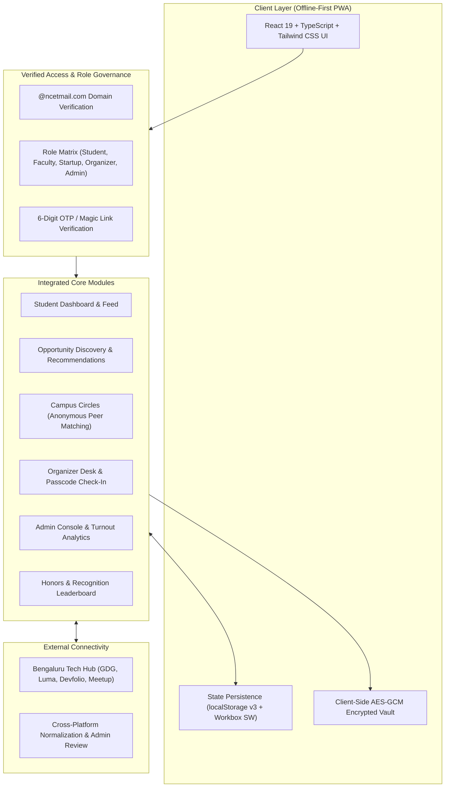

# NCET Connect — Integrated Smart Campus & Opportunity Ecosystem

[](https://github.com/Bhanucharanreddy46/NCET-Connect-/actions/workflows/deploy.yml)
[](https://react.dev/)
[](https://www.typescriptlang.org/)
[](https://vitejs.dev/)
[](https://tailwindcss.com/)
[](https://developer.mozilla.org/en-US/docs/Web/Progressive_web_apps)

> **One Campus. One Platform. Endless Opportunities.**

**NCET Connect** is a unified Smart Campus engagement, career discovery, and peer collaboration platform designed specifically for the students, faculty, clubs, and administrators of **Nagarjuna College of Engineering and Technology (NCET)**.

---

## 🌟 Vision & Overview

Campuses often struggle with fragmented communication across WhatsApp groups, posters, and disjointed portals. **NCET Connect** centralizes:
- **Campus Club Activities & Fests:** Technical workshops, inter-departmental hackathons, code sprints, and guest lectures.
- **Industry & Internship Opportunities:** Curated internships, graduate trainee openings, and research assistantships.
- **Bengaluru Tech Community Hub:** Direct connection to Bengaluru's thriving developer ecosystem (Google Developer Groups, Devfolio, HasGeek, PyData, Luma).
- **Campus Circles (Anonymous Peer Connect):** An interest-driven, zero-exposure peer discovery space where students connect based on skills, hackathon goals, and shared projects without disclosing their real names until mutual consent.
- **Verified Operations:** Physical check-in desks with 6-digit venue passcodes, real-time attendance tracking, CSV exports, and targeted broadcasts.

---

## 🏛️ System Architecture



---

## 🚀 Key Modules & Capabilities

### 1. Authentication & Verified Student Access
- **Institutional Boundary:** Account registration is restricted to official `@ncetmail.com` email addresses.
- **Role-Based Access Control (RBAC):** Distinct roles for `student`, `club_organizer`, `faculty`, `startup`, `ngo`, and `admin`.
- **OTP Verification:** 6-digit magic code verification flow to ensure email ownership.
- **Demo Identity Switcher:** Instant 1-click test access for Student (Priya Nair), Faculty (Dr. Kavitha), Startup Recruiter (Rohan Mehta), and Campus Admin.

### 2. Opportunity Discovery & Recommendation Engine
- **Global Search:** Real-time search across titles, required tech skills, host clubs, and campus venues.
- **Multi-Dimensional Filters:**
  - **Type:** Internships, Hackathons, Competitions, Workshops, Fests, Seminars, Meetups, Campus Projects.
  - **Mode:** In-Person (Offline), Remote (Online), Hybrid.
  - **Location:** On Campus, Bengaluru City, Remote.
  - **Department:** CSE, AIML, ISE, ECE, ME.
- **Personalized AI Recommendation Engine:** Computes a multi-objective match score for each student:
  $$\text{Score} = 0.30\text{SkillFit} + 0.20\text{InterestFit} + 0.15\text{DeptFit} + 0.15\text{AvailFit} + 0.10\text{LocationFit} + 0.10\text{UrgencyFit}$$
- **Transparent Explanations:** Every recommended card explicitly explains why it was suggested (e.g., *"Matches your ReactJS and TypeScript skills and aligns with your AI/ML interest"*).
- **Application Tracking:** Submit applications with statements of interest, track status (`applied`, `shortlisted`, `selected`, `rejected`), and bookmark opportunities.

### 3. Campus Circles — Anonymous Peer Connect
Campus Circles is an interest-based peer discovery and collaboration environment designed with privacy at its core:
- **Decoupled Community Identity:** Students interact under generated pseudonymous handles (e.g., `Quantum Badger #482`, `Silicon Falcon #919`). Real names, USNs, and institutional emails are never shown on public cards or chat headers.
- **Explainable Peer Match Formula:**
  $$\text{PeerScore} = 0.30\text{InterestOverlap} + 0.25\text{SkillComplement} + 0.20\text{IntentMatch} + 0.15\text{AvailabilityMatch} + 0.10\text{ActivityScore}$$
- **Connection Intents:** Find teammates for *Hackathons*, *Project Partners*, *Study Groups*, *Volunteer Work*, *Internship Prep*, *Club Collaboration*, and *Open Source*.
- **In-App Anonymous Chat:** Real-time messaging with message flagging and moderation escalations.
- **Two-Step Mutual Consent Identity Reveal:** Real identities (`@ncetmail.com`) are revealed **only** when both students explicitly check and confirm *"I agree to reveal my verified NCET institutional identity"*.

### 4. Organizer Portal & Attendance Operations
- **Club & Department Context Switcher:** Manage events on behalf of *GDG on Campus*, *Robotics Club*, *CodeChef NCET Chapter*, *E-Cell*, or *CSE Department*.
- **Event Creation Workflow:** Define schedules, physical venues, maximum capacities, and auto-generated 6-digit venue check-in passcodes (`ROBO99`, `GDG782`, `HACK36`).
- **Live Attendance Recording Desk:** Real-time participant roster with instant "Mark Present" toggle, attendance percentage calculations, and one-click **Export Attendance CSV** generator.
- **Targeted Broadcast Notifications:** Dispatch departmental and academic-year targeted announcements.

### 5. Admin Console & Engagement Analytics
- **Event Approval Queue:** Review and approve or reject submissions from student clubs and organizers with feedback logging.
- **Applications Management Desk:** Central candidate pipeline tracking with *Shortlist*, *Select*, and *Reject* workflows.
- **External Event Ingestion Desk:** Ingestion queue for events from Luma, Devfolio, Meetup, and Hack2skill before they appear on student feeds.
- **Non-Stigmatizing Engagement Analytics:** Measures department turnout rates (e.g., Computer Science at 86%, AIML at 85%) to identify campus programming demand without ever ranking or labeling individual students with skill deficits.
- **Community Moderation Desk:** Review flagged anonymous messages and comments with *Dismiss* or *Remove & Quarantine* actions.
- **User Governance:** Audit verified `@ncetmail.com` accounts and manage elevated organizer privileges.

### 6. Student Recognition & Leaderboard
- **11 Verified Badges:**
  - 📚 **Active Learner** (Event & workshop attendance)
  - 💻 **Hackathon Participant** (Code sprints & hackathons)
  - 🏆 **Hackathon Winner** (Podium finishes)
  - 🤝 **Club Contributor** (Active club involvement)
  - 🌐 **Open-Source Contributor** (Merged GitHub pull requests)
  - 💚 **Community Volunteer** (Event volunteering & logistics)
  - 📋 **Event Organizer** (Hosting campus activities)
  - ⭐ **Campus Ambassador** (Representing NCET externally)
  - 🔬 **Research Contributor** (Technical papers & lab benchmarks)
  - 🧭 **Mentor** (Peer guidance & tutoring)
  - 💡 **Innovation Champion** (Prototypes & innovation challenges)
- **Healthy Leaderboard:** Celebrates positive participation and peer collaboration across branches.
- **Volunteer Opt-In Desk:** Students can volunteer for campus festivals and technical workshops with a single click.

### 7. Encrypted Document Vault & Biometrics
- **Client-Side AES-GCM-256 Encryption:** Securely store sensitive academic transcripts, marksheets, and identity documents in the browser.
- **Biometric Passkey Support:** WebAuthn / TouchID / Windows Hello unlock integration.

---

## 📁 Repository Structure

```text
c:\Users\DELL\Downloads\NCET-Connect--main/
├── .github/
│   └── workflows/
│       ├── codeql.yml          # Automated security & code quality scanning
│       └── deploy.yml          # Automated GitHub Pages build & deploy
├── public/
│   ├── icon.svg                # Application brand icon
│   └── pwa-*.png               # PWA app icons (192px, 512px, maskable)
├── src/
│   ├── assets/                 # Campus hero & avatar imagery
│   ├── components/
│   │   ├── AdminDashboardView.tsx       # Admin queue, analytics, users & ingestion
│   │   ├── AnonymousConnectView.tsx     # Pseudonymous discussion feed & aggregate polls
│   │   ├── AuthView.tsx                 # @ncetmail.com login/signup & OTP verification
│   │   ├── CampusCirclesView.tsx        # Peer matching, anonymous chat & mutual reveal
│   │   ├── MessagingView.tsx            # Recruiter & direct encrypted messages
│   │   ├── OpportunityDiscoveryView.tsx # Global opportunity search, filters & recommendations
│   │   ├── OrganizerPortalView.tsx      # Club switcher, event authoring & attendance desk
│   │   ├── ProfileAdvisorView.tsx       # Institutional profile, USN verification & badges
│   │   ├── PWAControls.tsx              # Offline indicator & PWA installation prompts
│   │   ├── RecognitionView.tsx          # 11 badges gallery & active student leaderboard
│   │   ├── StudentFeedView.tsx          # Campus announcements & calendar/card views
│   │   ├── TrackerAnalyticsView.tsx     # Student application tracking kanban
│   │   └── VaultView.tsx                # Client-side AES-GCM encrypted document safe
│   ├── data/
│   │   └── seedData.ts         # Rich mock dataset (clubs, events, external meetups, users)
│   ├── hooks/
│   │   ├── useNcetStore.ts     # Offline-first state store (localStorage v3 persistence)
│   │   ├── useOnlineStatus.ts  # Network connectivity detector
│   │   └── usePWAInstall.ts    # Native PWA install event listener
│   ├── types/
│   │   └── ncet.ts             # Complete TypeScript data contracts
│   ├── utils/
│   │   ├── biometric.ts        # WebAuthn passkey helper
│   │   ├── crypto.ts           # Web Crypto AES-GCM-256 encryption & decryption
│   │   ├── export.ts           # CSV attendance & application export utility
│   │   └── recommender.ts      # Multi-objective recommendation scoring logic
│   ├── App.tsx                 # Root layout & multi-tab navigation shell
│   ├── main.tsx                # Application mount point & PWA service worker registration
│   └── index.css               # Tailwind CSS stylesheet
├── .gitignore
├── index.html
├── package.json
├── tsconfig.json
├── vite.config.ts
└── README.md
```

---

## 🛠️ Technology Stack

| Layer | Technologies |
|---|---|
| **Core Framework** | React 19, TypeScript 5+, Vite 8 |
| **Styling & Design** | Tailwind CSS v4, Lucide React Icons, Motion |
| **PWA & Offline** | Vite Plugin PWA, Workbox Service Worker, LocalStorage v3 Cache |
| **Security & Crypto** | Web Crypto API (`AES-GCM-256`), WebAuthn Biometrics, SHA-256 |
| **Deployment** | GitHub Pages via GitHub Actions CI/CD |

---

## 💻 Getting Started Locally

### Prerequisites
- **Node.js**: v20 or higher (v22+ recommended)
- **npm**: v10 or higher

### Installation

1. **Clone the repository:**
   ```bash
   git clone https://github.com/Bhanucharanreddy46/NCET-Connect-.git
   cd NCET-Connect-
   ```

2. **Install dependencies:**
   ```bash
   npm install --legacy-peer-deps
   ```

3. **Start the development server:**
   ```bash
   npm run dev
   ```

4. **Open in your browser:**
   ```text
   http://localhost:5173/
   ```

### Quality & Build Verification

- **Run TypeScript type checks:**
  ```bash
  npx tsc --noEmit
  ```

- **Run production build:**
  ```bash
  npx vite build
  ```

- **Preview the production build locally:**
  ```bash
  npx vite preview
  ```

---

## 🔒 Security & Privacy Principles

1. **Institutional Verification:** Student registration is restricted to official `@ncetmail.com` domains.
2. **Decoupled Privacy in Campus Circles:** Pseudonymous community aliases (`@QuantumBadger_482`) are decoupled from institutional records (`USN: 1NC23CS094`, real names, official emails).
3. **Mutual-Consent Identity Disclosure:** Real contact information is never exposed without explicit two-way opt-in consent from both students.
4. **Non-Stigmatizing Analytics:** Analytics measure departmental turnout and opportunity category demand to improve college programming without negatively labeling or ranking individual students.
5. **Client-Side Document Encryption:** Vault documents are encrypted using AES-GCM-256 keys derived locally in the user's browser.

---

## 📄 License & Attribution

Developed for **Nagarjuna College of Engineering and Technology (NCET)**.  
Distributed under the MIT License. See [SECURITY.md](file:///c:/Users/DELL/Downloads/NCET-Connect--main/SECURITY.md) for security policy and reporting guidelines.
