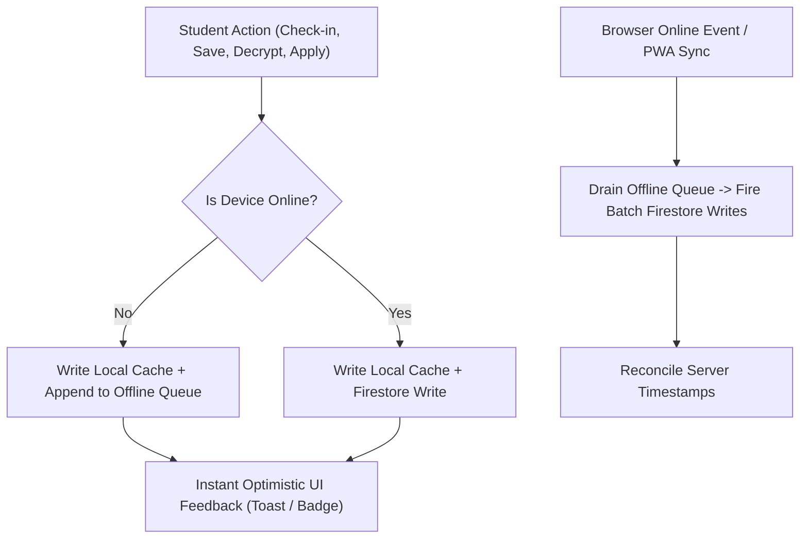

# NCET Connect — Minimum Viable Offline Contract (My Journey)

**Date:** November 14, 2026  
**Status:** Approved  
**Target Space:** `My Journey` (`journey`)  

---

## 1. Objective

Students often experience spotty Wi-Fi coverage across lecture halls, labs, and campus auditoriums.  
The **My Journey** workspace must remain 100% functional offline for its four critical student capabilities:
1. Reviewing submitted applications & withdrawal requests
2. Browsing & toggling saved opportunity bookmarks
3. Viewing & decrypting secured Vault documents
4. Checking into events using venue passcodes with automatic sync

---

## 2. Offline Capability Matrix

| Feature | Offline Behavior | Conflict Strategy | Storage Tier |
|---|---|---|---|
| **Applications Tracker** | Full read access to all applied items; status labels, interview dates, and notes viewable offline. | Local state authoritative; status updates from organizers sync when reconnected. | LocalStorage (`ncet_v3_applications`) |
| **Saved Bookmarks** | 1-click toggle save / unsave works immediately with zero network. | Last-Action-Wins with timestamp. | LocalStorage (`ncet_v3_saved`) |
| **Encrypted Safe (Vault)** | AES-GCM-256 decryption runs entirely client-side via Web Crypto API with no network needed. | Additions stored locally in ciphertext. | LocalStorage (`ncet_v3_vault`) |
| **Attendance Passport** | Entering a 6-digit venue passcode checks local published opportunity codes. Attendance is marked instantly into local passport. | Queued in `ncet_v3_pending_checkins` and posted to Firestore once connection restores. | LocalStorage (`ncet_v3_attendance`) + Sync Queue |

---

## 3. Data Flow Diagram



---

## 4. Pending Action Queue Contract

```typescript
export interface QueuedOfflineAction {
  id: string;
  type: 'CHECK_IN_ATTENDANCE' | 'SAVE_OPPORTUNITY' | 'UNSAVE_OPPORTUNITY' | 'APPLY_OPPORTUNITY' | 'WITHDRAW_APPLICATION';
  payload: Record<string, unknown>;
  queuedAt: string;
  retryCount: number;
}
```

When network connectivity resumes:
1. `useOnlineStatus` signals `online: true`.
2. Sync worker reads `ncet_v3_pending_queue`.
3. Dispatches remote Firestore setDoc / updateDoc operations.
4. Clears successfully processed items from the queue.
